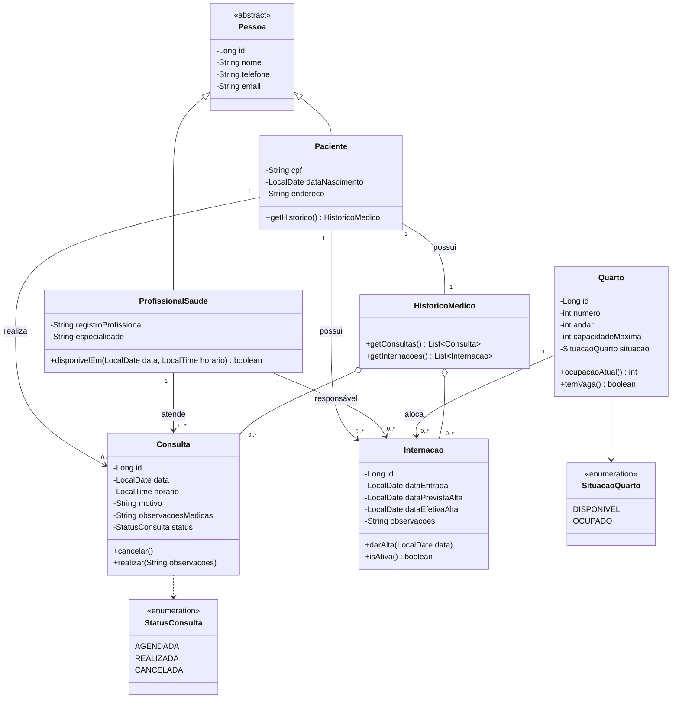

# Diagrama de Classes - Sistema Hospitalar

Renderiza no GitHub/VS Code (preview Markdown) ou abra [diagrama-de-classes.html](diagrama-de-classes.html) no navegador para imprimir/exportar.

## Regras de negócio refletidas

| Regra | Onde fica |
|---|---|
| Paciente tem várias consultas/internações | associações `1 → 0..*` |
| Consulta tem paciente e profissional | `Consulta` ligada a `Paciente` e `ProfissionalSaude` |
| Profissional sem dois atendimentos no mesmo horário | `ProfissionalSaude.disponivelEm()` (validada no Service) |
| Internação exige quarto disponível | `Quarto.temVaga()` |
| Quarto não excede capacidade | `Quarto.capacidadeMaxima` + `ocupacaoAtual()` |
| Histórico de consultas e internações | `HistoricoMedico` |
